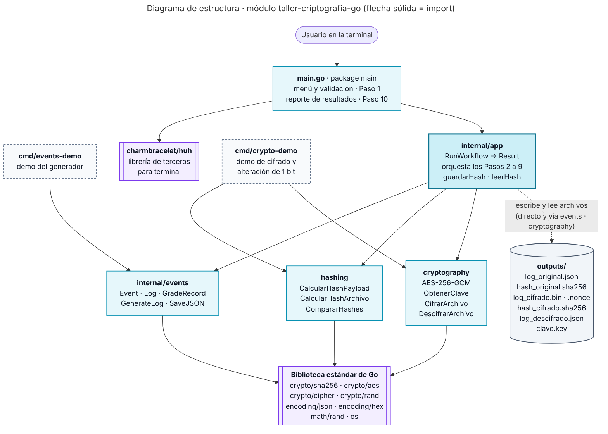
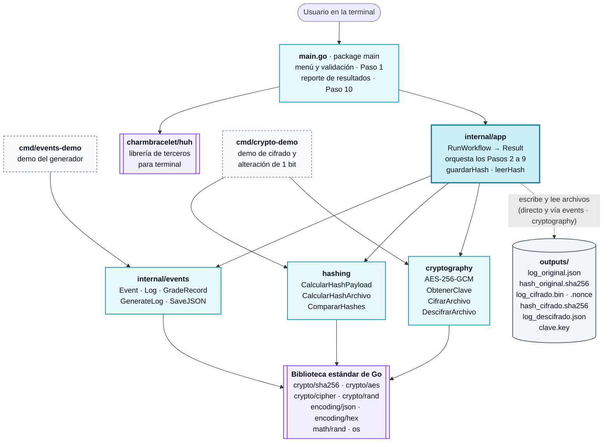
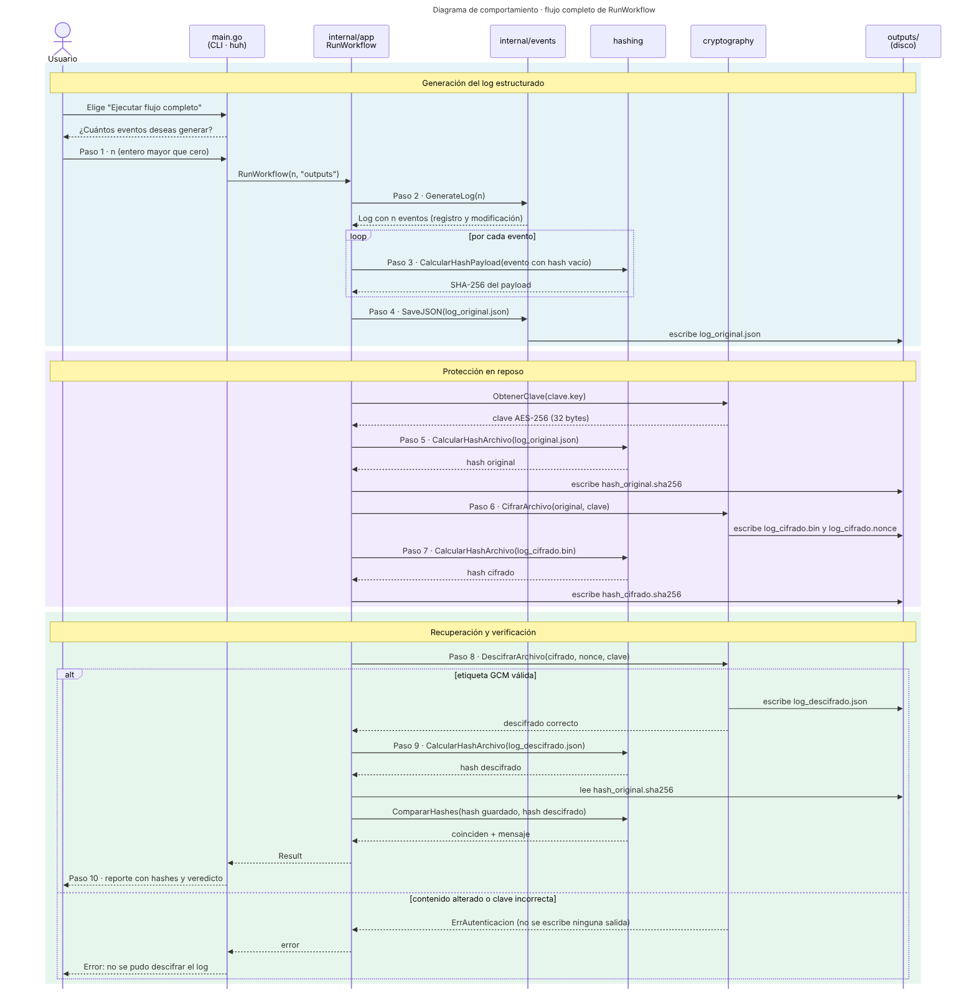
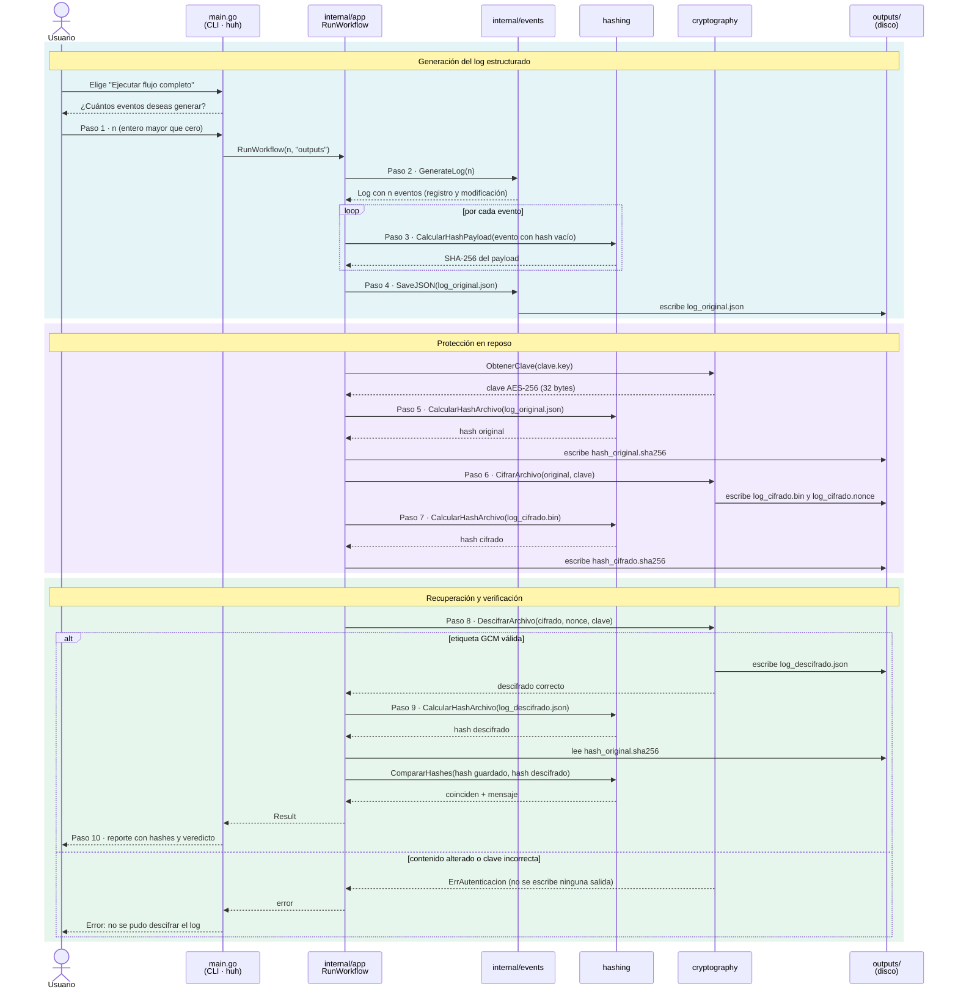

# Diagramas de diseño

Las fuentes están en Mermaid (`.mmd`) y las imágenes (`.png`, `.svg`) se generaron a partir de ellas. GitHub renderiza los bloques de abajo directamente.

Para regenerar las imágenes con Mermaid CLI:

```sh
npx -p @mermaid-js/mermaid-cli mmdc -i estructura.mmd -o estructura.png -b white -s 2
npx -p @mermaid-js/mermaid-cli mmdc -i comportamiento.mmd -o comportamiento.png -b white -s 2
```

## Diagrama de estructura

Paquetes del módulo y sus dependencias. Las flechas sólidas son `import`; la punteada es lectura y escritura de archivos en `outputs/`.





## Diagrama de comportamiento

Secuencia completa de `RunWorkflow`, del Paso 1 al Paso 10, incluida la rama de error cuando la etiqueta GCM no es válida.




